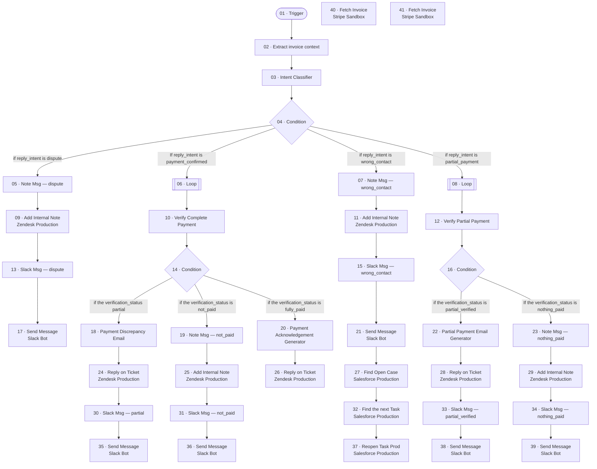

# PRD_Betterment_AR_Agent_Inbound

_Generated by `scripts/export.py` from `raw/`. Don't edit by hand._

| | |
|---|---|
| Agent ID | `56180518-a836-4998-b63b-fefc179cd0b6` |
| Graph ID | `73aecd7e-318f-4b0b-8a3b-139c373df0cb` |
| Graph status | draft (isDraft=True, isPublished=False) |
| Type / category | pre-configured-agent / - |
| Nodes / edges | 41 / 38 |
| Last export | 2026-11-05 |

## Trigger

The BeamAI API doesn't return trigger configuration (provider, event, filters, webhook). The entry node is `01-trigger`. Record the trigger from the Beam UI in `NOTES.md`.

## Flow

## Nodes

| # | Node | Type | Tool | Model (fallbacks) | What it does |
|---|---|---|---|---|---|
| 01 | [Trigger](nodes/01-trigger/) | entryNode / custom_gpt_tool | `GPTAction_Custom__llrN` | `GEMINI_3_FLASH` (GEMINI_3_1_PRO,GPT4_1,CLAUDE_4_SONNET) | Entry Node |
| 02 | [Extract invoice context](nodes/02-extract-invoice-context/) | executionNode / custom_gpt_tool | `GPTAction_Custom_Extractinvoicecontext` | `GEMINI_3_5_FLASH_LITE` (GEMINI_3_1_PRO,GPT4_1,CLAUDE_4_SONNET) | Extract the invoice context |
| 03 | [Intent Classifier](nodes/03-intent-classifier/) | executionNode / custom_gpt_tool | `GPTAction_Custom_IntentClassifier_wVjn` | `GPT4_1_MINI` (GEMINI_3_1_PRO,GPT4_1,CLAUDE_4_SONNET) | Classify the intent of the email |
| 04 | [Condition](nodes/04-condition/) | conditionNode |  | `GEMINI_3_FLASH` | Branches: if reply_intent is dispute; If reply_intent is payment_confirmed; if reply_intent is wrong_contact; if reply_intent is partial_pa… |
| 05 | [Note Msg — dispute](nodes/05-note-msg-dispute/) | executionNode / custom_gpt_tool | `GPTAction_Custom__j9TT` | `GEMINI_25_FLASH` (GEMINI_3_1_PRO) | Create the internal note message — dispute |
| 06 | [Loop](nodes/06-loop/) | loopingNode / custom_gpt_tool | `GPTAction_Custom__lNvS` | `GEMINI_3_FLASH` (GEMINI_3_1_PRO,GPT4_1,CLAUDE_4_SONNET) | Loops over 02-extract-invoice-context.output.invoice_ids |
| 07 | [Note Msg — wrong_contact](nodes/07-note-msg-wrong-contact/) | executionNode / custom_gpt_tool | `GPTAction_Custom__7PRI` | `GEMINI_25_FLASH` (GEMINI_3_1_PRO) | Create the internal note message — wrong_contact |
| 08 | [Loop](nodes/08-loop/) | loopingNode / custom_gpt_tool | `GPTAction_Custom__b9hg` | `GEMINI_3_FLASH` (GEMINI_3_1_PRO,GPT4_1,CLAUDE_4_SONNET) | Loops over 02-extract-invoice-context.output.invoice_ids |
| 09 | [Add Internal Note](nodes/09-add-internal-note/) | executionNode / custom_integration_tool | `CustomApiTool_AddInternalNote_c26w57WV` [Zendesk Production](../../shared/integrations/zendesk-production.json) | `GEMINI_3_FLASH` (GEMINI_3_1_PRO,GPT4_1,CLAUDE_4_SONNET) | Add internal note on slack telling about dispute |
| 10 | [Verify Complete Payment](nodes/10-verify-complete-payment/) | executionNode / custom_gpt_tool | `GPTAction_Custom_VerifyCompletePayment` | `GEMINI_3_FLASH` (GEMINI_3_1_PRO,GPT4_1,CLAUDE_4_SONNET) | verify if the invoices are paid |
| 11 | [Add Internal Note](nodes/11-add-internal-note/) | executionNode / custom_integration_tool | `CustomApiTool_AddInternalNote_c26w57WV` [Zendesk Production](../../shared/integrations/zendesk-production.json) | `GEMINI_25_FLASH` (GEMINI_3_1_PRO) | write internal note on zendesk identifying wrong contact |
| 12 | [Verify Partial Payment](nodes/12-verify-partial-payment/) | executionNode / custom_gpt_tool | `GPTAction_Custom_VerifyPartialPayment` | `GPT4_1` (GEMINI_3_1_PRO,CLAUDE_4_SONNET) | verify if the customer claimed invoices are paid |
| 13 | [Slack Msg — dispute](nodes/13-slack-msg-dispute/) | executionNode / custom_gpt_tool | `GPTAction_Custom__hj9i` | `GEMINI_25_FLASH` (GEMINI_3_1_PRO) | Create the Slack alert message — Invoice disputed |
| 14 | [Condition](nodes/14-condition/) | conditionNode |  | `GEMINI_3_FLASH` | Branches: if the verification_status partial; if the verification_status is not_paid; if the verification_status is fully_paid |
| 15 | [Slack Msg — wrong_contact](nodes/15-slack-msg-wrong-contact/) | executionNode / custom_gpt_tool | `GPTAction_Custom__H7lo` | `GEMINI_25_FLASH` (GEMINI_3_1_PRO) | Create the Slack alert message — Wrong billing contact |
| 16 | [Condition](nodes/16-condition/) | conditionNode |  | `GEMINI_3_FLASH` | Branches: if the verification_status is partial_verified; If the verification_status is nothing_paid |
| 17 | [Send Message](nodes/17-send-message/) | executionNode / beam_tool | `slack_bot-send-message` [Slack Bot](../../shared/integrations/slack-bot.json) | `GEMINI_25_FLASH` (GEMINI_3_1_PRO) | Send an alert on slack |
| 18 | [Payment Discrepancy Email](nodes/18-payment-discrepancy-email/) | executionNode / custom_gpt_tool | `GPTAction_Custom_PaymentDiscrepancyEmail` | `GPT4_1` (GEMINI_3_1_PRO,GPT4_1,CLAUDE_4_SONNET) | send email to the client saying that partial payment has been made |
| 19 | [Note Msg — not_paid](nodes/19-note-msg-not-paid/) | executionNode / custom_gpt_tool | `GPTAction_Custom__LA2E` | `GEMINI_3_1_PRO` (GEMINI_3_1_PRO,GPT4_1,CLAUDE_4_SONNET) | Create the internal note message — not_paid |
| 20 | [Payment Acknowledgement Generator](nodes/20-payment-acknowledgement-generator/) | executionNode / custom_gpt_tool | `GPTAction_Custom_PaymentAcknowledgementGenerator` | `GEMINI_3_FLASH` (GEMINI_3_1_PRO,GPT4_1,CLAUDE_4_SONNET) | Generate the email to be sent for acknowledgement of the completed paymenr |
| 21 | [Send Message](nodes/21-send-message/) | executionNode / beam_tool | `slack_bot-send-message` [Slack Bot](../../shared/integrations/slack-bot.json) | `GEMINI_25_FLASH` (GEMINI_3_1_PRO) | Send an alert on slack |
| 22 | [Partial Payment Email Generator](nodes/22-partial-payment-email-generator/) | executionNode / custom_gpt_tool | `GPTAction_Custom_PartialPaymentEmailGenerator` | `GPT4_1` (GEMINI_3_1_PRO,GPT4_1,CLAUDE_4_SONNET) | create the email for the client acknowledging the partial payment |
| 23 | [Note Msg — nothing_paid](nodes/23-note-msg-nothing-paid/) | executionNode / custom_gpt_tool | `GPTAction_Custom__B9Ts` | `GEMINI_25_FLASH` (GEMINI_3_1_PRO) | Create the internal note message — nothing_paid |
| 24 | [Reply on Ticket](nodes/24-reply-on-ticket/) | executionNode / custom_integration_tool | `CustomApiTool_ReplyonTicket_92UuZvCl` [Zendesk Production](../../shared/integrations/zendesk-production.json) | `GEMINI_3_FLASH` (GEMINI_3_1_PRO,GPT4_1,CLAUDE_4_SONNET) | Send the email to the client communicating about the partial payment |
| 25 | [Add Internal Note](nodes/25-add-internal-note/) | executionNode / custom_integration_tool | `CustomApiTool_AddInternalNote_c26w57WV` [Zendesk Production](../../shared/integrations/zendesk-production.json) | `GEMINI_3_FLASH` (GEMINI_3_1_PRO,GPT4_1,CLAUDE_4_SONNET) | Add an internal note on Zendesk |
| 26 | [Reply on Ticket](nodes/26-reply-on-ticket/) | executionNode / custom_integration_tool | `CustomApiTool_ReplyonTicket_92UuZvCl` [Zendesk Production](../../shared/integrations/zendesk-production.json) | `GEMINI_3_FLASH` (GEMINI_3_1_PRO,GPT4_1,CLAUDE_4_SONNET) | Send the acknowledgement to the client |
| 27 | [Find Open Case](nodes/27-find-open-case/) | executionNode / custom_integration_tool | `CustomApiTool_FindOpenCase_SZTduIRV` [Salesforce Production](../../shared/integrations/salesforce-production.json) | `GEMINI_25_FLASH` (GEMINI_3_1_PRO) | Find the delinquency case (inbound wrong-contact) |
| 28 | [Reply on Ticket](nodes/28-reply-on-ticket/) | executionNode / custom_integration_tool | `CustomApiTool_ReplyonTicket_92UuZvCl` [Zendesk Production](../../shared/integrations/zendesk-production.json) | `GEMINI_3_FLASH` (GEMINI_3_1_PRO,GPT4_1,CLAUDE_4_SONNET) | Send the email to the client confirming about the partial payment |
| 29 | [Add Internal Note](nodes/29-add-internal-note/) | executionNode / custom_integration_tool | `CustomApiTool_AddInternalNote_c26w57WV` [Zendesk Production](../../shared/integrations/zendesk-production.json) | `GEMINI_3_FLASH` (GEMINI_3_1_PRO,GPT4_1,CLAUDE_4_SONNET) | Set an internal note on zendesk identifying discrepancy |
| 30 | [Slack Msg — partial](nodes/30-slack-msg-partial/) | executionNode / custom_gpt_tool | `GPTAction_Custom__JQdE` | `GEMINI_3_1_PRO` (GEMINI_3_1_PRO,GPT4_1,CLAUDE_4_SONNET) | Create the Slack alert message — Payment claimed — only partial found |
| 31 | [Slack Msg — not_paid](nodes/31-slack-msg-not-paid/) | executionNode / custom_gpt_tool | `GPTAction_Custom__ea5e` | `GEMINI_3_1_PRO` (GEMINI_3_1_PRO,GPT4_1,CLAUDE_4_SONNET) | Create the Slack alert message — Payment claimed — NOT paid |
| 32 | [Find the next Task](nodes/32-find-the-next-task/) | executionNode / custom_integration_tool | `CustomApiTool_FindthenextTask` [Salesforce Production](../../shared/integrations/salesforce-production.json) | `GEMINI_25_FLASH` (GEMINI_3_1_PRO) | Find the most recent Beam-completed task (inbound wrong-contact) |
| 33 | [Slack Msg — partial_verified](nodes/33-slack-msg-partial-verified/) | executionNode / custom_gpt_tool | `GPTAction_Custom__3Tig` | `GEMINI_25_FLASH` (GEMINI_3_1_PRO) | Create the Slack alert message — Partial payment confirmed |
| 34 | [Slack Msg — nothing_paid](nodes/34-slack-msg-nothing-paid/) | executionNode / custom_gpt_tool | `GPTAction_Custom__ThSH` | `GEMINI_25_FLASH` (GEMINI_3_1_PRO) | Create the Slack alert message — Partial claimed — nothing found |
| 35 | [Send Message](nodes/35-send-message/) | executionNode / beam_tool | `slack_bot-send-message` [Slack Bot](../../shared/integrations/slack-bot.json) | `GEMINI_25_FLASH` (GEMINI_3_1_PRO) | Send alert on slack |
| 36 | [Send Message](nodes/36-send-message/) | executionNode / beam_tool | `slack_bot-send-message` [Slack Bot](../../shared/integrations/slack-bot.json) | `GEMINI_25_FLASH` (GEMINI_3_1_PRO,GPT4_1,CLAUDE_4_SONNET) | Send an alert on slack |
| 37 | [Reopen Task Prod](nodes/37-reopen-task-prod/) | executionNode / custom_integration_tool | `CustomApiTool_ReopenTaskProd` [Salesforce Production](../../shared/integrations/salesforce-production.json) | `GEMINI_25_FLASH` (GEMINI_3_1_PRO) | Uncomplete the task |
| 38 | [Send Message](nodes/38-send-message/) | executionNode / beam_tool | `slack_bot-send-message` [Slack Bot](../../shared/integrations/slack-bot.json) | `GEMINI_25_FLASH` (GEMINI_3_1_PRO,GPT4_1,CLAUDE_4_SONNET) | Send alert on slack identifying partia payment |
| 39 | [Send Message](nodes/39-send-message/) | executionNode / beam_tool | `slack_bot-send-message` [Slack Bot](../../shared/integrations/slack-bot.json) | `GEMINI_25_FLASH` (GEMINI_3_1_PRO) | Send alert internally on slack |
| 40 | [Fetch Invoice](nodes/40-fetch-invoice/) | executionNode / custom_integration_tool | `CustomApiTool_FetchInvoice` [Stripe Sandbox](../../shared/integrations/stripe-sandbox.json) | `GEMINI_3_FLASH` (GEMINI_3_1_PRO,GPT4_1,CLAUDE_4_SONNET) | Fetch the invoices from the stripe |
| 41 | [Fetch Invoice](nodes/41-fetch-invoice/) | executionNode / custom_integration_tool | `CustomApiTool_FetchInvoice` [Stripe Sandbox](../../shared/integrations/stripe-sandbox.json) | `GEMINI_3_FLASH` (GEMINI_3_1_PRO,GPT4_1,CLAUDE_4_SONNET) | Fetch the invoices from the stripe |

## Edges

| From | To | Condition | Edge ID |
|---|---|---|---|
| `01-trigger` | `02-extract-invoice-context` |  | `0c5f1d69-b72f-4ec5-9ab4-b5fa791f9f23` |
| `02-extract-invoice-context` | `03-intent-classifier` |  | `7be63f43-8a84-41b9-b2a3-4941fe2b8a1a` |
| `03-intent-classifier` | `04-condition` |  | `58465f4f-1a4a-4a9e-b4c3-4dff6fea56f5` |
| `04-condition` | `05-note-msg-dispute` | if reply_intent is dispute | `955fdfd0-5c35-4a6a-b1eb-7dad277a138d` |
| `04-condition` | `06-loop` | If reply_intent is payment_confirmed | `5ffc3b99-2c64-4838-b4ba-1d0494447b1c` |
| `04-condition` | `07-note-msg-wrong-contact` | if reply_intent is wrong_contact | `f6f8ed33-b90b-459b-a049-11cc6ec17fd8` |
| `04-condition` | `08-loop` | if reply_intent is partial_payment | `0b93927d-6420-4d24-b985-c3f9eb2a6f96` |
| `05-note-msg-dispute` | `09-add-internal-note` |  | `2e309525-d74e-47d3-8021-b1a4ce576e43` |
| `06-loop` | `10-verify-complete-payment` |  | `47aa586d-d820-413e-8302-3043d6f558a2` |
| `07-note-msg-wrong-contact` | `11-add-internal-note` |  | `07e3986d-a43c-4df4-ac15-8192ec4f5d9b` |
| `08-loop` | `12-verify-partial-payment` |  | `289f892e-aefa-45f4-b80e-8f43e2c9fee0` |
| `09-add-internal-note` | `13-slack-msg-dispute` |  | `9399b440-4cad-4c95-a51d-c94f2afcfad1` |
| `10-verify-complete-payment` | `14-condition` |  | `b5fe2734-fa5b-421a-90a9-f2111c1f1282` |
| `11-add-internal-note` | `15-slack-msg-wrong-contact` |  | `090f9bbb-78df-47e9-b06f-e81bcca7e7fb` |
| `12-verify-partial-payment` | `16-condition` |  | `9b177f27-c5af-40eb-ac35-471d009118a6` |
| `13-slack-msg-dispute` | `17-send-message` |  | `0730c916-3873-4683-a74b-05bb610aa127` |
| `14-condition` | `18-payment-discrepancy-email` | if the verification_status partial | `c69c0bcb-761f-4461-9d7f-41baa1d7b38a` |
| `14-condition` | `19-note-msg-not-paid` | if the verification_status is not_paid | `3811c56c-04b5-478f-94ef-792935da8206` |
| `14-condition` | `20-payment-acknowledgement-generator` | if the verification_status is fully_paid | `399fc954-6ddf-47a4-b2be-5cfecfe080c2` |
| `15-slack-msg-wrong-contact` | `21-send-message` |  | `33c0c971-0b7a-4033-a63b-72ec528bfabf` |
| `16-condition` | `22-partial-payment-email-generator` | if the verification_status is partial_verified | `fcfff610-2983-4ecc-8649-09cd347d441c` |
| `16-condition` | `23-note-msg-nothing-paid` | If the verification_status is nothing_paid | `3567d126-422e-4985-b7f5-6d30009885bd` |
| `18-payment-discrepancy-email` | `24-reply-on-ticket` |  | `2f11b96e-6fc2-470e-b63d-6a14e88c825d` |
| `19-note-msg-not-paid` | `25-add-internal-note` |  | `5ee7ce46-f3ff-44f5-98f2-d8804ea6de16` |
| `20-payment-acknowledgement-generator` | `26-reply-on-ticket` |  | `14fcfe68-359c-4886-b0ec-2aa5f1880d8a` |
| `21-send-message` | `27-find-open-case` |  | `41929f32-3dfb-4944-8c9e-8882084a192f` |
| `22-partial-payment-email-generator` | `28-reply-on-ticket` |  | `99aa71bb-fa6f-4f2e-803f-3e95691e8607` |
| `23-note-msg-nothing-paid` | `29-add-internal-note` |  | `1ebdbcaf-ec16-4b02-8a47-80b0b8aa985c` |
| `24-reply-on-ticket` | `30-slack-msg-partial` |  | `6fe0b8e4-343c-42c2-9f61-7b120c7bdff1` |
| `25-add-internal-note` | `31-slack-msg-not-paid` |  | `14b9af48-3672-4b3b-a3af-c82f6e0943d7` |
| `27-find-open-case` | `32-find-the-next-task` |  | `f13cee20-dab8-43fd-861b-b74ceb51a892` |
| `28-reply-on-ticket` | `33-slack-msg-partial-verified` |  | `4d9e7ca9-bd2a-4145-8ebd-691df07eb8ba` |
| `29-add-internal-note` | `34-slack-msg-nothing-paid` |  | `b0977c2b-e340-4693-99ba-288cf2620558` |
| `30-slack-msg-partial` | `35-send-message` |  | `bfe8978e-bb0e-4750-8913-720af8d4ca0b` |
| `31-slack-msg-not-paid` | `36-send-message` |  | `ee499c04-cae9-41c3-b687-a4d5e406fc3b` |
| `32-find-the-next-task` | `37-reopen-task-prod` |  | `d48ab7eb-b77a-45a9-afd6-4e766c81a8b3` |
| `33-slack-msg-partial-verified` | `38-send-message` |  | `9316a401-86c8-4cd2-8337-7799de8458da` |
| `34-slack-msg-nothing-paid` | `39-send-message` |  | `da3fd6e2-5670-4097-a9d6-d2fd375e3e23` |

## Integrations

- [Salesforce Production](../../shared/integrations/salesforce-production.json)
- [Slack Bot](../../shared/integrations/slack-bot.json)
- [Stripe Sandbox](../../shared/integrations/stripe-sandbox.json)
- [Zendesk Production](../../shared/integrations/zendesk-production.json)

## Agent settings

Source: `raw/nodes/*.json` → `agentGraph.agent.settings`, plus `reasoningEffort` and the governance fields.

- `governanceEnabled`: `False`
- `instructions`: (empty)
- `preferredModel`: `"GEMINI_3_FLASH"`

## Files

- `raw/graph.json`, `raw/nodes/<nodeId>.json`: API responses, with credentials and sample values removed only.
- `graph.json`: the raw graph with keys sorted, timestamps and canvas coordinates removed.
- `nodes/<NN>-<name>/`: `node.json` (internal IDs get a `__readable` partner key), `code.<ext>`, `prompt.md`, `inputs.md`.
