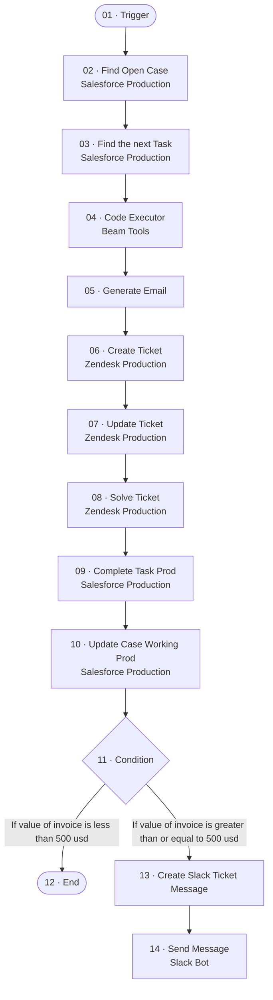

# PRD_Betterment_AR_Agent

_Generated by `scripts/export.py` from `raw/`. Don't edit by hand._

| | |
|---|---|
| Agent ID | `c8a3e542-cb80-4f89-b0ba-b64e685284d1` |
| Graph ID | `bbf94f07-77c8-44ee-8bcb-34d452ab62f3` |
| Graph status | draft (isDraft=True, isPublished=False) |
| Type / category | pre-configured-agent / - |
| Nodes / edges | 14 / 13 |
| Last export | 2026-11-05 |

## Trigger

The BeamAI API doesn't return trigger configuration (provider, event, filters, webhook). The entry node is `01-trigger`. Record the trigger from the Beam UI in `NOTES.md`.

## Flow

## Nodes

| # | Node | Type | Tool | Model (fallbacks) | What it does |
|---|---|---|---|---|---|
| 01 | [Trigger](nodes/01-trigger/) | entryNode / custom_gpt_tool | `GPTAction_Custom__wNkc` | `GEMINI_3_FLASH` (GEMINI_3_1_PRO,GPT4_1,CLAUDE_4_SONNET) | Entry Node |
| 02 | [Find Open Case](nodes/02-find-open-case/) | executionNode / custom_integration_tool | `CustomApiTool_FindOpenCase_SZTduIRV` [Salesforce Production](../../shared/integrations/salesforce-production.json) | `GEMINI_3_1_PRO` (GPT5) | find the case |
| 03 | [Find the next Task](nodes/03-find-the-next-task/) | executionNode / custom_integration_tool | `CustomApiTool_FindthenextTask` [Salesforce Production](../../shared/integrations/salesforce-production.json) | `GEMINI_3_1_PRO` (GPT5) | find the task |
| 04 | [Code Executor](nodes/04-code-executor/) | executionNode / code_executor_tool | `StandAloneAction_CodeExecutor` [Beam Tools](../../shared/integrations/beam-tools.json) |  (GEMINI_3_1_PRO,GPT4_1,CLAUDE_4_SONNET) | create the necessary inputs for the email |
| 05 | [Generate Email](nodes/05-generate-email/) | executionNode / custom_gpt_tool | `GPTAction_Custom_GenerateEmail` | `GPT4_1` (GEMINI_3_1_PRO,GPT4_1,CLAUDE_4_SONNET) | generate email to put on zendesk |
| 06 | [Create Ticket](nodes/06-create-ticket/) | executionNode / custom_integration_tool | `CustomApiTool_CreateTicket_4JRVzsqI` [Zendesk Production](../../shared/integrations/zendesk-production.json) | `GEMINI_3_FLASH` (GPT4_1_MINI,GPT4_1,CLAUDE_4_SONNET) | Create the zendesk ticket |
| 07 | [Update Ticket](nodes/07-update-ticket/) | executionNode / custom_integration_tool | `CustomApiTool_UpdateTicket_mpFI5a43` [Zendesk Production](../../shared/integrations/zendesk-production.json) | `GEMINI_25_FLASH` (GEMINI_3_1_PRO) | Update the ticket with brand/group |
| 08 | [Solve Ticket](nodes/08-solve-ticket/) | executionNode / custom_integration_tool | `CustomApiTool_SolveTicket_iJjUtVlK` [Zendesk Production](../../shared/integrations/zendesk-production.json) | `GEMINI_25_FLASH` (GEMINI_3_1_PRO) | Solve the ticket by sending the email |
| 09 | [Complete Task Prod](nodes/09-complete-task-prod/) | executionNode / custom_integration_tool | `CustomApiTool_CompleteTaskProd` [Salesforce Production](../../shared/integrations/salesforce-production.json) | `GEMINI_3_1_PRO` (GPT5_2) | complete the task |
| 10 | [Update Case Working Prod](nodes/10-update-case-working-prod/) | executionNode / custom_integration_tool | `CustomApiTool_UpdateCaseWorkingProd` [Salesforce Production](../../shared/integrations/salesforce-production.json) | `GEMINI_3_1_PRO` (GPT5) | update the case status to working |
| 11 | [Condition](nodes/11-condition/) | conditionNode |  | `GEMINI_3_1_PRO` (GPT5) | Branches: If value of invoice is less than 500 usd; If value of invoice is greater than or equal to 500 usd |
| 12 | [End](nodes/12-end/) | executionNode |  |  |  |
| 13 | [Create Slack Ticket Message](nodes/13-create-slack-ticket-message/) | executionNode / custom_gpt_tool | `GPTAction_Custom__W4CH` | `GEMINI_3_FLASH` (GEMINI_3_1_PRO,GPT4_1,CLAUDE_4_SONNET) | Create the Slack message announcing the newly created Zendesk ticket |
| 14 | [Send Message](nodes/14-send-message/) | executionNode / beam_tool | `slack_bot-send-message` [Slack Bot](../../shared/integrations/slack-bot.json) | `GEMINI_3_FLASH` (GPT4_1_MINI,GPT4_1,CLAUDE_4_SONNET) | notify the team on slack |

## Edges

| From | To | Condition | Edge ID |
|---|---|---|---|
| `01-trigger` | `02-find-open-case` |  | `d8d50e92-e1d1-4d65-b89a-a038cbda5846` |
| `02-find-open-case` | `03-find-the-next-task` |  | `3cae41d1-de37-4bbd-a99d-724eea896507` |
| `03-find-the-next-task` | `04-code-executor` |  | `025871a3-f17c-4c8f-91a5-0e0504bbd99c` |
| `04-code-executor` | `05-generate-email` |  | `84127aa7-3ec4-4856-af24-e60b8bc31d23` |
| `05-generate-email` | `06-create-ticket` |  | `d70f1d0c-8a04-4bf8-80dd-5db40f81053b` |
| `06-create-ticket` | `07-update-ticket` |  | `f1157604-64fd-4f4e-8815-1961af25f1f3` |
| `07-update-ticket` | `08-solve-ticket` |  | `79c1b8e4-144c-4d5b-b35e-e8e9db6bd55e` |
| `08-solve-ticket` | `09-complete-task-prod` |  | `ab318474-e52e-4837-85aa-c21bca1bfb9c` |
| `09-complete-task-prod` | `10-update-case-working-prod` |  | `1978d11f-7ce8-4e12-a54b-09d5c21a6a90` |
| `10-update-case-working-prod` | `11-condition` |  | `c492ad7c-e20d-4e1b-9119-f1146c3d0f8a` |
| `11-condition` | `12-end` | If value of invoice is less than 500 usd | `3b3ebe9c-5501-4c5c-ace8-4fc71247deb4` |
| `11-condition` | `13-create-slack-ticket-message` | If value of invoice is greater than or equal to 500 usd | `56a8bb0b-c134-4355-8335-79b92b6351b5` |
| `13-create-slack-ticket-message` | `14-send-message` |  | `d2e3e91d-d2d3-4e5b-91af-301c73773649` |

## Integrations

- [Beam Tools](../../shared/integrations/beam-tools.json)
- [Salesforce Production](../../shared/integrations/salesforce-production.json)
- [Slack Bot](../../shared/integrations/slack-bot.json)
- [Zendesk Production](../../shared/integrations/zendesk-production.json)

## Agent settings

Source: `raw/nodes/*.json` → `agentGraph.agent.settings`, plus `reasoningEffort` and the governance fields.

- `governanceEnabled`: `False`
- `agentPersonality`: (empty)
- `agentRestrictions`: (empty)
- `instructions`: (empty)
- `preferredModel`: (empty)
- `prompts`: `["Can you check this recent payment reply from a customer and tell me what next steps we should take?", "I'd like to generate a polite reminder email for an invoice that's about 35 days overdue. Can you help with that?", "Could you create a Zendesk ticket with the details of this overdue invoice and notify our Slack team about it?", "Please verify if the amount the customer paid matches the invoice total recorded in Stripe, and let me know if there are any discrepancies.", "Let's update the status of this Salesforce task related to an overdue invoice and add any relevant notes."]`

## Files

- `raw/graph.json`, `raw/nodes/<nodeId>.json`: API responses, with credentials and sample values removed only.
- `graph.json`: the raw graph with keys sorted, timestamps and canvas coordinates removed.
- `nodes/<NN>-<name>/`: `node.json` (internal IDs get a `__readable` partner key), `code.<ext>`, `prompt.md`, `inputs.md`.
