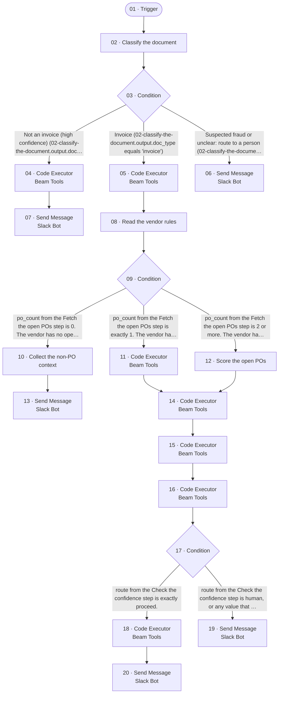

# TST_Betterment_AP_Agent_v2

_Generated by `scripts/export.py` from `raw/`. Don't edit by hand._

| | |
|---|---|
| Agent ID | `f2bd02dc-6f1a-4f46-8f6e-7193ccadad4d` |
| Graph ID | `0832d275-3287-49fd-9a90-faed1ba0b298` |
| Graph status | draft (isDraft=True, isPublished=False) |
| Type / category | pre-configured-agent / - |
| Nodes / edges | 20 / 20 |
| Last export | 2026-11-05 |

## Trigger

The BeamAI API doesn't return trigger configuration (provider, event, filters, webhook). The entry node is `01-trigger`. Record the trigger from the Beam UI in `NOTES.md`.

## Flow

## Nodes

| # | Node | Type | Tool | Model (fallbacks) | What it does |
|---|---|---|---|---|---|
| 01 | [Trigger](nodes/01-trigger/) | entryNode / custom_gpt_tool | `GPTAction_Custom__eCJT` |  | Entry Node |
| 02 | [Classify the document](nodes/02-classify-the-document/) | executionNode / custom_gpt_tool | `GPTAction_Custom_Classifythedocument` | `GEMINI_3_FLASH` | Classify the Inbox item as an invoice, not an invoice or suspected fraud |
| 03 | [Condition](nodes/03-condition/) | conditionNode |  |  | Branches: Not an invoice (high confidence) (02-classify-the-document.output.doc_type equals 'not_invoice'); Invoice (02-classify-the-docume… |
| 04 | [Code Executor](nodes/04-code-executor/) | executionNode / code_executor_tool | `StandAloneAction_CodeExecutor` [Beam Tools](../../shared/integrations/beam-tools.json) | `GEMINI_3_FLASH` | Prepare the archive note for an item that is not an invoice |
| 05 | [Code Executor](nodes/05-code-executor/) | executionNode / code_executor_tool | `StandAloneAction_CodeExecutor` [Beam Tools](../../shared/integrations/beam-tools.json) | `GEMINI_3_FLASH` | Fetch the open POs and the request history of the vendor from Zip |
| 06 | [Send Message](nodes/06-send-message/) | executionNode / beam_tool | `slack_bot-send-message` [Slack Bot](../../shared/integrations/slack-bot.json) | `GEMINI_3_FLASH` | Hand off the suspected fraud or unclear item to AP in Slack |
| 07 | [Send Message](nodes/07-send-message/) | executionNode / beam_tool | `slack_bot-send-message` [Slack Bot](../../shared/integrations/slack-bot.json) | `GEMINI_3_FLASH` | Post the archive note to the AP review channel in Slack |
| 08 | [Read the vendor rules](nodes/08-read-the-vendor-rules/) | executionNode / custom_gpt_tool | `GPTAction_Custom_Readthevendorrules` | `GEMINI_3_FLASH` | Read the vendor rules for this vendor |
| 09 | [Condition](nodes/09-condition/) | conditionNode |  | `GEMINI_3_FLASH` | Branches: po_count from the Fetch the open POs step is 0. The vendor has no open PO.; po_count from the Fetch the open POs step is exactly … |
| 10 | [Collect the non-PO context](nodes/10-collect-the-non-po-context/) | executionNode / custom_gpt_tool | `GPTAction_Custom_Collectthenon-POcontext` | `GEMINI_3_FLASH` | Collect the context for the non-PO invoice without coding it |
| 11 | [Code Executor](nodes/11-code-executor/) | executionNode / code_executor_tool | `StandAloneAction_CodeExecutor` [Beam Tools](../../shared/integrations/beam-tools.json) | `GEMINI_3_FLASH` | Check the one open PO of the vendor |
| 12 | [Score the open POs](nodes/12-score-the-open-pos/) | executionNode / custom_gpt_tool | `GPTAction_Custom_ScoretheopenPOs` | `GEMINI_3_1_PRO` | Score the open POs and select exactly one PO |
| 13 | [Send Message](nodes/13-send-message/) | executionNode / beam_tool | `slack_bot-send-message` [Slack Bot](../../shared/integrations/slack-bot.json) | `GEMINI_3_FLASH` | Post the non-PO invoice to the non-PO queue in Slack |
| 14 | [Code Executor](nodes/14-code-executor/) | executionNode / code_executor_tool | `StandAloneAction_CodeExecutor` [Beam Tools](../../shared/integrations/beam-tools.json) | `GEMINI_3_FLASH` | Prepare the bill: posting date, lines and coding from the PO |
| 15 | [Code Executor](nodes/15-code-executor/) | executionNode / code_executor_tool | `StandAloneAction_CodeExecutor` [Beam Tools](../../shared/integrations/beam-tools.json) | `GEMINI_3_FLASH` | Check the hard rules H1 to H8 |
| 16 | [Code Executor](nodes/16-code-executor/) | executionNode / code_executor_tool | `StandAloneAction_CodeExecutor` [Beam Tools](../../shared/integrations/beam-tools.json) | `GEMINI_3_FLASH` | Check the confidence and draft the Slack message |
| 17 | [Condition](nodes/17-condition/) | conditionNode |  | `GEMINI_3_FLASH` | Branches: route from the Check the confidence step is exactly proceed.; route from the Check the confidence step is human, or any value tha… |
| 18 | [Code Executor](nodes/18-code-executor/) | executionNode / code_executor_tool | `StandAloneAction_CodeExecutor` [Beam Tools](../../shared/integrations/beam-tools.json) | `GEMINI_3_FLASH` | Write the PO and the bill to Zip in Phase 2 (switch off) |
| 19 | [Send Message](nodes/19-send-message/) | executionNode / beam_tool | `slack_bot-send-message` [Slack Bot](../../shared/integrations/slack-bot.json) | `GEMINI_3_FLASH` | Hand off the invoice to AP in the Slack review channel |
| 20 | [Send Message](nodes/20-send-message/) | executionNode / beam_tool | `slack_bot-send-message` [Slack Bot](../../shared/integrations/slack-bot.json) | `GEMINI_3_FLASH` | Post the proposal to the AP review channel in Slack |

## Edges

| From | To | Condition | Edge ID |
|---|---|---|---|
| `01-trigger` | `02-classify-the-document` |  | `dcd96ebc-e698-45b9-843e-9745711e2bfa` |
| `02-classify-the-document` | `03-condition` |  | `03c7e368-5369-4c30-813c-6a05c88914b3` |
| `03-condition` | `04-code-executor` | Not an invoice (high confidence) (02-classify-the-document.output.doc_type equals 'not_invoice') | `2bf58000-47a5-4f7e-919e-b98f078f05ca` |
| `03-condition` | `05-code-executor` | Invoice (02-classify-the-document.output.doc_type equals 'invoice') | `ea55aafa-5789-4fad-b7b9-91f4140ce2a4` |
| `03-condition` | `06-send-message` | Suspected fraud or unclear: route to a person (02-classify-the-document.output.doc_type not_equals 'invoice' AND 02-classify-the-document.output.doc_type not_equals 'not_invoice') | `5d42c774-8190-4b66-ac0c-7cf1a3d15fb7` |
| `04-code-executor` | `07-send-message` |  | `33eaff86-e85c-41cc-8ed0-f90894b67ebb` |
| `05-code-executor` | `08-read-the-vendor-rules` |  | `f648ac38-5671-4528-ad65-92b4221ab4c2` |
| `08-read-the-vendor-rules` | `09-condition` |  | `6d098bac-eec5-4de5-858a-61982b1f2d59` |
| `09-condition` | `10-collect-the-non-po-context` | po_count from the Fetch the open POs step is 0. The vendor has no open PO. | `724a0aaa-5969-4f33-9c58-51e2071173ec` |
| `09-condition` | `11-code-executor` | po_count from the Fetch the open POs step is exactly 1. The vendor has one open PO. | `554b4b15-7af1-4deb-b049-f3ebb2c7a712` |
| `09-condition` | `12-score-the-open-pos` | po_count from the Fetch the open POs step is 2 or more. The vendor has several open POs. | `b9ab11ab-3ac0-49c5-bca3-1b7520360787` |
| `10-collect-the-non-po-context` | `13-send-message` |  | `178e5e8d-d672-49af-84dc-a4ff595fb66e` |
| `11-code-executor` | `14-code-executor` |  | `879bdcfd-9e1c-4f98-b4ef-2957ce0c5f19` |
| `12-score-the-open-pos` | `14-code-executor` |  | `22098d26-7683-41a6-94ae-b0f648551c49` |
| `14-code-executor` | `15-code-executor` |  | `20e1640c-bf9c-4e10-a256-86443d3db382` |
| `15-code-executor` | `16-code-executor` |  | `3c727e9e-1543-47d6-acc4-96790c2e923d` |
| `16-code-executor` | `17-condition` |  | `e8e2dec5-99d3-4551-b94a-35ee151cd1b9` |
| `17-condition` | `18-code-executor` | route from the Check the confidence step is exactly proceed. | `d8547c73-d428-42bb-bfb7-51cfd63ba7db` |
| `17-condition` | `19-send-message` | route from the Check the confidence step is human, or any value that is not proceed. | `c400d309-359e-4a6b-82d3-892a35134230` |
| `18-code-executor` | `20-send-message` |  | `03d8bd11-9859-44a4-816c-25105591982f` |

## Integrations

- [Beam Tools](../../shared/integrations/beam-tools.json)
- [Slack Bot](../../shared/integrations/slack-bot.json)

## Agent settings

Source: `raw/nodes/*.json` → `agentGraph.agent.settings`, plus `reasoningEffort` and the governance fields.

- `governanceEnabled`: `False`
- `instructions`: (empty)
- `preferredModel`: `"GEMINI_3_FLASH"`
- `prompts`: (empty)

## Files

- `raw/graph.json`, `raw/nodes/<nodeId>.json`: API responses, with credentials and sample values removed only.
- `graph.json`: the raw graph with keys sorted, timestamps and canvas coordinates removed.
- `nodes/<NN>-<name>/`: `node.json` (internal IDs get a `__readable` partner key), `code.<ext>`, `prompt.md`, `inputs.md`.
