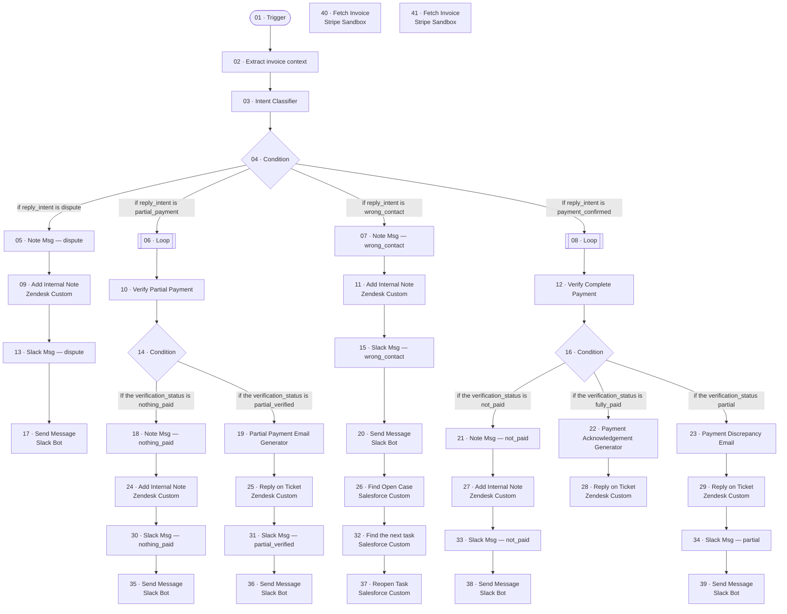

# TST_Betterment AR Agent - Inbound

_Generated by `scripts/export.py` from `raw/`. Don't edit by hand._

| | |
|---|---|
| Agent ID | `ca09ff3c-4dc0-488d-9415-3b4666301e94` |
| Graph ID | `05a27cb0-a5d3-4f43-8c75-30c1dddaab09` |
| Graph status | draft (isDraft=True, isPublished=False) |
| Type / category | pre-configured-agent / - |
| Nodes / edges | 41 / 38 |
| Last export | 2026-11-05 |

## Trigger

The BeamAI API doesn't return trigger configuration (provider, event, filters, webhook). The entry node is `01-trigger`. Record the trigger from the Beam UI in `NOTES.md`.

## Flow

## Nodes

| # | Node | Type | Tool | Model (fallbacks) | What it does |
|---|---|---|---|---|---|
| 01 | [Trigger](nodes/01-trigger/) | entryNode / custom_gpt_tool | `GPTAction_Custom__llrN` | `GEMINI_3_FLASH` (GEMINI_3_1_PRO,GPT4_1,CLAUDE_4_SONNET) | Entry Node |
| 02 | [Extract invoice context](nodes/02-extract-invoice-context/) | executionNode / custom_gpt_tool | `GPTAction_Custom_Extractinvoicecontext` | `GEMINI_3_5_FLASH_LITE` (GEMINI_3_1_PRO,GPT4_1,CLAUDE_4_SONNET) | Extract the invoice context |
| 03 | [Intent Classifier](nodes/03-intent-classifier/) | executionNode / custom_gpt_tool | `GPTAction_Custom_IntentClassifier_wVjn` | `GPT4_1_MINI` (GEMINI_3_1_PRO,GPT4_1,CLAUDE_4_SONNET) | Classify the intent of the email |
| 04 | [Condition](nodes/04-condition/) | conditionNode |  | `GEMINI_3_FLASH` | Branches: if reply_intent is dispute; if reply_intent is partial_payment; if reply_intent is wrong_contact; If reply_intent is payment_conf… |
| 05 | [Note Msg — dispute](nodes/05-note-msg-dispute/) | executionNode / custom_gpt_tool | `GPTAction_Custom__j9TT` | `GEMINI_3_FLASH` (GEMINI_3_1_PRO,GPT4_1,CLAUDE_4_SONNET) | Create the internal note message — dispute |
| 06 | [Loop](nodes/06-loop/) | loopingNode / custom_gpt_tool | `GPTAction_Custom__b9hg` | `GEMINI_3_FLASH` (GEMINI_3_1_PRO,GPT4_1,CLAUDE_4_SONNET) | Loops over 02-extract-invoice-context.output.invoice_ids |
| 07 | [Note Msg — wrong_contact](nodes/07-note-msg-wrong-contact/) | executionNode / custom_gpt_tool | `GPTAction_Custom__7PRI` | `GEMINI_3_FLASH` (GEMINI_3_1_PRO,GPT4_1,CLAUDE_4_SONNET) | Create the internal note message — wrong_contact |
| 08 | [Loop](nodes/08-loop/) | loopingNode / custom_gpt_tool | `GPTAction_Custom__lNvS` | `GEMINI_3_FLASH` (GEMINI_3_1_PRO,GPT4_1,CLAUDE_4_SONNET) | Loops over 02-extract-invoice-context.output.invoice_ids |
| 09 | [Add Internal Note](nodes/09-add-internal-note/) | executionNode / custom_integration_tool | `CustomApiTool_AddInternalNote` [Zendesk Custom](../../shared/integrations/zendesk-custom.json) | `GEMINI_3_FLASH` (GEMINI_3_1_PRO,GPT4_1,CLAUDE_4_SONNET) | Add internal note on slack telling about dispute |
| 10 | [Verify Partial Payment](nodes/10-verify-partial-payment/) | executionNode / custom_gpt_tool | `GPTAction_Custom_VerifyPartialPayment` | `GPT4_1` (GEMINI_3_1_PRO,CLAUDE_4_SONNET) | verify if the customer claimed invoices are paid |
| 11 | [Add Internal Note](nodes/11-add-internal-note/) | executionNode / custom_integration_tool | `CustomApiTool_AddInternalNote` [Zendesk Custom](../../shared/integrations/zendesk-custom.json) | `GEMINI_3_FLASH` (GEMINI_3_1_PRO,GPT4_1,CLAUDE_4_SONNET) | write internal note on zendesk identifying wrong contact |
| 12 | [Verify Complete Payment](nodes/12-verify-complete-payment/) | executionNode / custom_gpt_tool | `GPTAction_Custom_VerifyCompletePayment` | `GEMINI_3_FLASH` (GEMINI_3_1_PRO,GPT4_1,CLAUDE_4_SONNET) | verify if the invoices are paid |
| 13 | [Slack Msg — dispute](nodes/13-slack-msg-dispute/) | executionNode / custom_gpt_tool | `GPTAction_Custom__hj9i` | `GEMINI_3_FLASH` (GEMINI_3_1_PRO,GPT4_1,CLAUDE_4_SONNET) | Create the Slack alert message — Invoice disputed |
| 14 | [Condition](nodes/14-condition/) | conditionNode |  | `GEMINI_3_FLASH` | Branches: If the verification_status is nothing_paid; if the verification_status is partial_verified |
| 15 | [Slack Msg — wrong_contact](nodes/15-slack-msg-wrong-contact/) | executionNode / custom_gpt_tool | `GPTAction_Custom__H7lo` | `GEMINI_3_FLASH` (GEMINI_3_1_PRO,GPT4_1,CLAUDE_4_SONNET) | Create the Slack alert message — Wrong billing contact |
| 16 | [Condition](nodes/16-condition/) | conditionNode |  | `GEMINI_3_FLASH` | Branches: if the verification_status is not_paid; if the verification_status is fully_paid; if the verification_status partial |
| 17 | [Send Message](nodes/17-send-message/) | executionNode / beam_tool | `slack_bot-send-message` [Slack Bot](../../shared/integrations/slack-bot.json) | `GEMINI_3_FLASH` (GEMINI_3_1_PRO,GPT4_1,CLAUDE_4_SONNET) | Send an alert on slack |
| 18 | [Note Msg — nothing_paid](nodes/18-note-msg-nothing-paid/) | executionNode / custom_gpt_tool | `GPTAction_Custom__B9Ts` | `GEMINI_3_FLASH` (GEMINI_3_1_PRO,GPT4_1,CLAUDE_4_SONNET) | Create the internal note message — nothing_paid |
| 19 | [Partial Payment Email Generator](nodes/19-partial-payment-email-generator/) | executionNode / custom_gpt_tool | `GPTAction_Custom_PartialPaymentEmailGenerator` | `GPT4_1` (GEMINI_3_1_PRO,GPT4_1,CLAUDE_4_SONNET) | create the email for the client acknowledging the partial payment |
| 20 | [Send Message](nodes/20-send-message/) | executionNode / beam_tool | `slack_bot-send-message` [Slack Bot](../../shared/integrations/slack-bot.json) | `GEMINI_3_FLASH` (GEMINI_3_1_PRO,GPT4_1,CLAUDE_4_SONNET) | Send an alert on slack |
| 21 | [Note Msg — not_paid](nodes/21-note-msg-not-paid/) | executionNode / custom_gpt_tool | `GPTAction_Custom__LA2E` | `GEMINI_3_FLASH` (GEMINI_3_1_PRO,GPT4_1,CLAUDE_4_SONNET) | Create the internal note message — not_paid |
| 22 | [Payment Acknowledgement Generator](nodes/22-payment-acknowledgement-generator/) | executionNode / custom_gpt_tool | `GPTAction_Custom_PaymentAcknowledgementGenerator` | `GEMINI_3_FLASH` (GEMINI_3_1_PRO,GPT4_1,CLAUDE_4_SONNET) | Generate the email to be sent for acknowledgement of the completed paymenr |
| 23 | [Payment Discrepancy Email](nodes/23-payment-discrepancy-email/) | executionNode / custom_gpt_tool | `GPTAction_Custom_PaymentDiscrepancyEmail` | `GPT4_1` (GEMINI_3_1_PRO,GPT4_1,CLAUDE_4_SONNET) | send email to the client saying that partial payment has been made |
| 24 | [Add Internal Note](nodes/24-add-internal-note/) | executionNode / custom_integration_tool | `CustomApiTool_AddInternalNote` [Zendesk Custom](../../shared/integrations/zendesk-custom.json) | `GEMINI_3_FLASH` (GEMINI_3_1_PRO,GPT4_1,CLAUDE_4_SONNET) | Set an internal note on zendesk identifying discrepancy |
| 25 | [Reply on Ticket](nodes/25-reply-on-ticket/) | executionNode / custom_integration_tool | `CustomApiTool_ReplyonTicket` [Zendesk Custom](../../shared/integrations/zendesk-custom.json) | `GEMINI_3_FLASH` (GEMINI_3_1_PRO,GPT4_1,CLAUDE_4_SONNET) | Send the email to the client confirming about the partial payment |
| 26 | [Find Open Case](nodes/26-find-open-case/) | executionNode / custom_integration_tool | `CustomApiTool_FindOpenCase` [Salesforce Custom](../../shared/integrations/salesforce-custom.json) | `GEMINI_3_FLASH` (GEMINI_3_1_PRO,GPT4_1,CLAUDE_4_SONNET) | Find the delinquency case (inbound wrong-contact) |
| 27 | [Add Internal Note](nodes/27-add-internal-note/) | executionNode / custom_integration_tool | `CustomApiTool_AddInternalNote` [Zendesk Custom](../../shared/integrations/zendesk-custom.json) | `GEMINI_3_FLASH` (GEMINI_3_1_PRO,GPT4_1,CLAUDE_4_SONNET) | Add an internal note on Zendesk |
| 28 | [Reply on Ticket](nodes/28-reply-on-ticket/) | executionNode / custom_integration_tool | `CustomApiTool_ReplyonTicket` [Zendesk Custom](../../shared/integrations/zendesk-custom.json) | `GEMINI_3_FLASH` (GEMINI_3_1_PRO,GPT4_1,CLAUDE_4_SONNET) | Send the acknowledgement to the client |
| 29 | [Reply on Ticket](nodes/29-reply-on-ticket/) | executionNode / custom_integration_tool | `CustomApiTool_ReplyonTicket` [Zendesk Custom](../../shared/integrations/zendesk-custom.json) | `GEMINI_3_FLASH` (GEMINI_3_1_PRO,GPT4_1,CLAUDE_4_SONNET) | Send the email to the client communicating about the partial payment |
| 30 | [Slack Msg — nothing_paid](nodes/30-slack-msg-nothing-paid/) | executionNode / custom_gpt_tool | `GPTAction_Custom__ThSH` | `GEMINI_3_FLASH` (GEMINI_3_1_PRO,GPT4_1,CLAUDE_4_SONNET) | Create the Slack alert message — Partial claimed — nothing found |
| 31 | [Slack Msg — partial_verified](nodes/31-slack-msg-partial-verified/) | executionNode / custom_gpt_tool | `GPTAction_Custom__3Tig` | `GEMINI_3_FLASH` (GEMINI_3_1_PRO,GPT4_1,CLAUDE_4_SONNET) | Create the Slack alert message — Partial payment confirmed |
| 32 | [Find the next task](nodes/32-find-the-next-task/) | executionNode / custom_integration_tool | `CustomApiTool_Findthenexttask` [Salesforce Custom](../../shared/integrations/salesforce-custom.json) | `GEMINI_3_FLASH` (GEMINI_3_1_PRO,GPT4_1,CLAUDE_4_SONNET) | Find the most recent Beam-completed task (inbound wrong-contact) |
| 33 | [Slack Msg — not_paid](nodes/33-slack-msg-not-paid/) | executionNode / custom_gpt_tool | `GPTAction_Custom__ea5e` | `GEMINI_3_FLASH` (GEMINI_3_1_PRO,GPT4_1,CLAUDE_4_SONNET) | Create the Slack alert message — Payment claimed — NOT paid |
| 34 | [Slack Msg — partial](nodes/34-slack-msg-partial/) | executionNode / custom_gpt_tool | `GPTAction_Custom__JQdE` | `GEMINI_3_FLASH` (GEMINI_3_1_PRO,GPT4_1,CLAUDE_4_SONNET) | Create the Slack alert message — Payment claimed — only partial found |
| 35 | [Send Message](nodes/35-send-message/) | executionNode / beam_tool | `slack_bot-send-message` [Slack Bot](../../shared/integrations/slack-bot.json) | `GEMINI_3_FLASH` (GEMINI_3_1_PRO,GPT4_1,CLAUDE_4_SONNET) | Send alert internally on slack |
| 36 | [Send Message](nodes/36-send-message/) | executionNode / beam_tool | `slack_bot-send-message` [Slack Bot](../../shared/integrations/slack-bot.json) | `GEMINI_3_FLASH` (GEMINI_3_1_PRO,GPT4_1,CLAUDE_4_SONNET) | Send alert on slack identifying partia payment |
| 37 | [Reopen Task](nodes/37-reopen-task/) | executionNode / custom_integration_tool | `CustomApiTool_ReopenTask` [Salesforce Custom](../../shared/integrations/salesforce-custom.json) | `GEMINI_3_FLASH` (GEMINI_3_1_PRO,GPT4_1,CLAUDE_4_SONNET) | Uncomplete the task |
| 38 | [Send Message](nodes/38-send-message/) | executionNode / beam_tool | `slack_bot-send-message` [Slack Bot](../../shared/integrations/slack-bot.json) | `GEMINI_3_FLASH` (GEMINI_3_1_PRO,GPT4_1,CLAUDE_4_SONNET) | Send an alert on slack |
| 39 | [Send Message](nodes/39-send-message/) | executionNode / beam_tool | `slack_bot-send-message` [Slack Bot](../../shared/integrations/slack-bot.json) | `GEMINI_3_FLASH` (GEMINI_3_1_PRO,GPT4_1,CLAUDE_4_SONNET) | Send alert on slack |
| 40 | [Fetch Invoice](nodes/40-fetch-invoice/) | executionNode / custom_integration_tool | `CustomApiTool_FetchInvoice` [Stripe Sandbox](../../shared/integrations/stripe-sandbox.json) | `GEMINI_3_FLASH` (GEMINI_3_1_PRO,GPT4_1,CLAUDE_4_SONNET) | Fetch the invoices from the stripe |
| 41 | [Fetch Invoice](nodes/41-fetch-invoice/) | executionNode / custom_integration_tool | `CustomApiTool_FetchInvoice` [Stripe Sandbox](../../shared/integrations/stripe-sandbox.json) | `GEMINI_3_FLASH` (GEMINI_3_1_PRO,GPT4_1,CLAUDE_4_SONNET) | Fetch the invoices from the stripe |

## Edges

| From | To | Condition | Edge ID |
|---|---|---|---|
| `01-trigger` | `02-extract-invoice-context` |  | `f82fd752-68fe-4a91-a403-c220c42fe136` |
| `02-extract-invoice-context` | `03-intent-classifier` |  | `888d6821-2c31-4c2b-89b5-7eb8b275dbbf` |
| `03-intent-classifier` | `04-condition` |  | `88292f1b-fc24-46f1-8249-344e8dce9155` |
| `04-condition` | `05-note-msg-dispute` | if reply_intent is dispute | `bfc61a7c-b51d-4eed-98d6-ee96c19197d8` |
| `04-condition` | `06-loop` | if reply_intent is partial_payment | `a4412931-fe0c-4129-bc8a-83ed842bcfc4` |
| `04-condition` | `07-note-msg-wrong-contact` | if reply_intent is wrong_contact | `9a7150e8-d438-4f8c-afd4-b72e4c00f624` |
| `04-condition` | `08-loop` | If reply_intent is payment_confirmed | `22d13eaf-72d5-4bf0-b6ff-d239e96156e2` |
| `05-note-msg-dispute` | `09-add-internal-note` |  | `d0502d79-b67f-445c-b00c-b93fc1c1ab8f` |
| `06-loop` | `10-verify-partial-payment` |  | `b2fd01a4-a4dd-4fd1-a328-76fdb3241c58` |
| `07-note-msg-wrong-contact` | `11-add-internal-note` |  | `76cf5795-c128-4dbe-ab08-10bf824bad62` |
| `08-loop` | `12-verify-complete-payment` |  | `03eaeb41-58d8-4713-a8ad-54395c29215c` |
| `09-add-internal-note` | `13-slack-msg-dispute` |  | `e7ef3754-d506-469f-a1b7-e0984aa64d18` |
| `10-verify-partial-payment` | `14-condition` |  | `6b35f74e-dcd3-428c-b173-848fd7ec7df7` |
| `11-add-internal-note` | `15-slack-msg-wrong-contact` |  | `d0fe817b-a515-49ac-b0f4-e686fe514eb1` |
| `12-verify-complete-payment` | `16-condition` |  | `07a88952-f8b5-4e05-99e1-f73545b2e90d` |
| `13-slack-msg-dispute` | `17-send-message` |  | `cbb6f19d-2077-4a99-9aa5-76138fa42790` |
| `14-condition` | `18-note-msg-nothing-paid` | If the verification_status is nothing_paid | `0f48d725-ae21-4d2d-b7bc-d3521440e488` |
| `14-condition` | `19-partial-payment-email-generator` | if the verification_status is partial_verified | `88c606c4-bc2c-4e06-bc7f-6396b69f5aa3` |
| `15-slack-msg-wrong-contact` | `20-send-message` |  | `73d043c4-b878-4b5b-8898-fdc4e850b933` |
| `16-condition` | `21-note-msg-not-paid` | if the verification_status is not_paid | `d9e97fbd-0448-4102-90c5-2b9e7eecd69e` |
| `16-condition` | `22-payment-acknowledgement-generator` | if the verification_status is fully_paid | `5aa41666-069f-4e43-a895-0f31893e16b7` |
| `16-condition` | `23-payment-discrepancy-email` | if the verification_status partial | `d7426b2d-c913-4028-83bc-ad6f753c24f6` |
| `18-note-msg-nothing-paid` | `24-add-internal-note` |  | `297dd778-bc78-4def-82c3-82ceee47b68f` |
| `19-partial-payment-email-generator` | `25-reply-on-ticket` |  | `823581e4-1c39-4438-8015-a21ce2824d51` |
| `20-send-message` | `26-find-open-case` |  | `a739d012-cf1e-4f49-9327-0803d219cd93` |
| `21-note-msg-not-paid` | `27-add-internal-note` |  | `e5621779-98f5-4356-8653-8a02052ebd22` |
| `22-payment-acknowledgement-generator` | `28-reply-on-ticket` |  | `5287b998-e1d7-4ed6-9ad5-57000f081bda` |
| `23-payment-discrepancy-email` | `29-reply-on-ticket` |  | `59c3e2d0-9de9-4a4b-9bc6-a9dd5798f558` |
| `24-add-internal-note` | `30-slack-msg-nothing-paid` |  | `f93e47c4-8cf5-4e27-a419-984e35e960fe` |
| `25-reply-on-ticket` | `31-slack-msg-partial-verified` |  | `96362b9d-42af-46fc-ac4f-930ae0ca5a46` |
| `26-find-open-case` | `32-find-the-next-task` |  | `7500ed99-2960-44c2-a928-2d70d0cf27e7` |
| `27-add-internal-note` | `33-slack-msg-not-paid` |  | `341dffe6-7e8f-47a1-b3c5-13b6b509a296` |
| `29-reply-on-ticket` | `34-slack-msg-partial` |  | `17c33067-c8ee-415d-8909-066f66ca9d31` |
| `30-slack-msg-nothing-paid` | `35-send-message` |  | `73a642f8-9d41-4234-8d2a-a05a53443ef3` |
| `31-slack-msg-partial-verified` | `36-send-message` |  | `44d546bd-54f2-40eb-81ee-1993daaa5d37` |
| `32-find-the-next-task` | `37-reopen-task` |  | `722aced5-913f-4ad2-8998-d6ef696d272b` |
| `33-slack-msg-not-paid` | `38-send-message` |  | `b603dd14-572b-4af3-be07-446e84cefcfa` |
| `34-slack-msg-partial` | `39-send-message` |  | `692e2c2f-a329-4847-bbaf-6b6f0ea02b38` |

## Integrations

- [Salesforce Custom](../../shared/integrations/salesforce-custom.json)
- [Slack Bot](../../shared/integrations/slack-bot.json)
- [Stripe Sandbox](../../shared/integrations/stripe-sandbox.json)
- [Zendesk Custom](../../shared/integrations/zendesk-custom.json)

## Agent settings

Source: `raw/nodes/*.json` → `agentGraph.agent.settings`, plus `reasoningEffort` and the governance fields.

- `governanceEnabled`: `False`
- `instructions`: (empty)
- `preferredModel`: `"GEMINI_3_FLASH"`

## Files

- `raw/graph.json`, `raw/nodes/<nodeId>.json`: API responses, with credentials and sample values removed only.
- `graph.json`: the raw graph with keys sorted, timestamps and canvas coordinates removed.
- `nodes/<NN>-<name>/`: `node.json` (internal IDs get a `__readable` partner key), `code.<ext>`, `prompt.md`, `inputs.md`.
